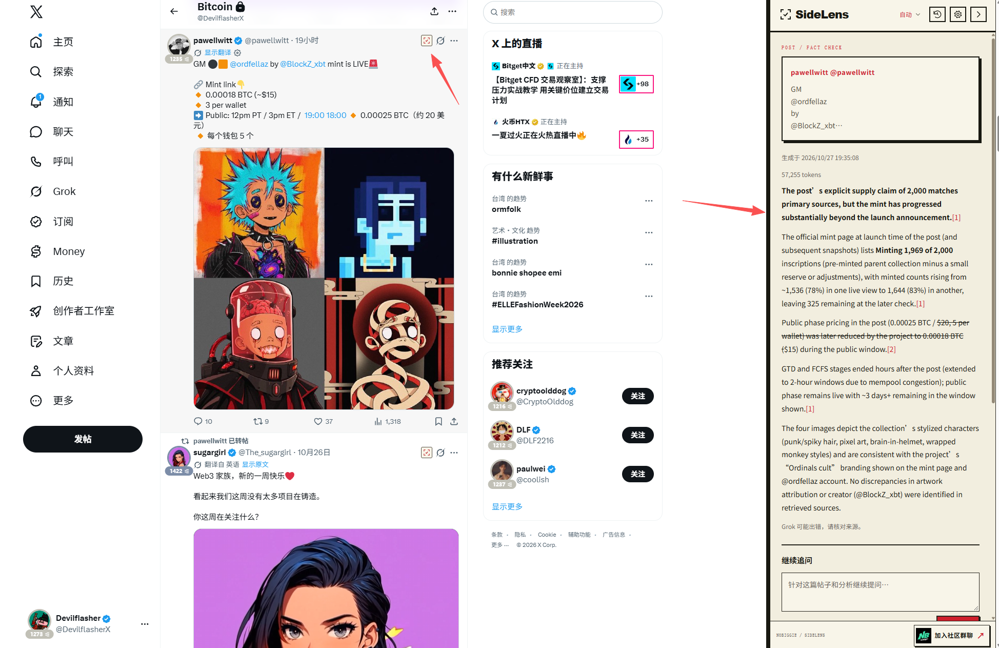

# Nobiggie SideLens

**Check a post. Ask a follow-up. Draft a thoughtful reply — without leaving X.**

[简体中文](README.zh-CN.md) · [Website](https://nobiggie.xyz/sidelens) · [Privacy](https://nobiggie.xyz/sidelens/privacy) · [Community](https://nobiggie.xyz/chat)

SideLens is an independent, MIT-licensed derivative of [SuperX](https://github.com/bwjoke/SuperX).
Thanks to the original author [@coolish](https://x.com/coolish) for their contribution.



Click the SideLens button beside a post to open its analysis and follow-up drawer.

## What it does

- **Analyze only when you click.** A compact button beside each post opens a right-side drawer. Scrolling alone never starts an analysis.
- **Reuse completed results.** A bounded, 24-hour local cache survives page reloads and browser restarts. “Analyze again” bypasses it.
- **Continue the conversation.** Ask questions about the post and analysis, or use three generated follow-up suggestions.
- **Draft your reply.** Choose tone, direction and an approximate 50 / 100 / 300 / 500 / 1000-character target. Edit, count and copy the result. Nothing is posted automatically.
- **Read comfortably.** Headings, quotes, lists and tables; automatic matching of X light, dim and black appearance.

Compared with the upstream flow, this derivative focuses on on-demand analysis, persistent result reuse, contextual follow-ups, configurable reply drafts and a redesigned reading interface. The provider integrations are inherited and adapted from SuperX; this project does not claim authorship of the original implementation.

## Install

Current version: **0.1.6**. As of 2026-10-27, Chrome Web Store review is pending; no public store installation link is announced here.

1. Download this repository with **Code → Download ZIP**, then extract it into a permanent folder.
2. Open `chrome://extensions` or `edge://extensions` and enable **Developer mode**.
3. Select **Load unpacked** and choose the **extension/** folder containing `manifest.json`.
4. Open SideLens settings and configure one Grok connection. Complete any official authorization yourself.
5. Refresh X and click the SideLens button beside a post.

Disable the original SuperX while testing to avoid both extensions handling the same page. Unpacked copies update manually: replace their files, reload the extension and refresh X.

## Bring your own Grok connection

Use an eligible Grok subscription login, an xAI API key, or the optional local Grok Build connection. No shared account, API key or free AI allowance is included. Account eligibility, models, limits, charges and data retention follow the provider's rules. Analyses, follow-ups, question suggestions and reply drafts can consume provider usage.

See [connection instructions](docs/CONNECTIONS.md). The guide includes clearly identified upstream acceptance history; it does not establish live acceptance of this fork.

## Local development

**Node.js 22+**. OAuth / API-key browser use and ordinary tests need no npm dependency installation.

```sh
node tools/validate.mjs
node tools/package-release.mjs
node tools/preview-server.mjs
```

Packages, source archives, inventories and SHA-256 checksums are written to `artifacts/`. The preview server uses simulated browser storage and responses; do not enter real credentials into it. Isolated browser checks additionally require Playwright and desktop Edge:

```sh
node tools/check-sidelens-browser.mjs http://127.0.0.1:PORT
```

Use the port printed by the preview server. Mock checks do not certify real X layouts, account eligibility or generated-answer accuracy.

## Privacy and security

Provider requests go to the configured xAI or loopback connection, with no additional SideLens analysis relay. Remembered credentials use local encryption; completed analysis caches and optional selected-post history are local and unencrypted. Follow-up conversations and reply drafts remain in page memory. Provider retention policies still apply.

[Privacy details](PRIVACY.md) · [Security policy](SECURITY.md) · [Source review](docs/SECURITY_REVIEW.md) · [Contributing](CONTRIBUTING.md) · [Changelog](CHANGELOG.md)

## Credits and license

Based on **[SuperX](https://github.com/bwjoke/SuperX)** at commit `5cfa125f9000866c1719afc452d1867ef37280bf`. **感谢原作者 [@coolish](https://x.com/coolish) 的贡献。**

The original [MIT license](LICENSE) and [Marked notices](extension/marked-LICENSE.txt) remain intact. Some internal filenames and protocol identifiers retain upstream names for compatibility. SideLens is not affiliated with X, Grok, xAI, Google or the original SuperX publisher.
