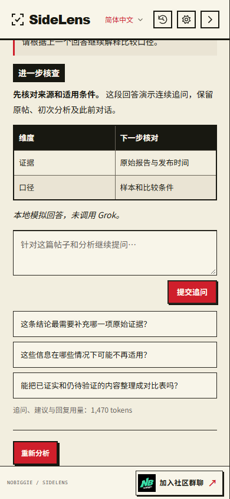
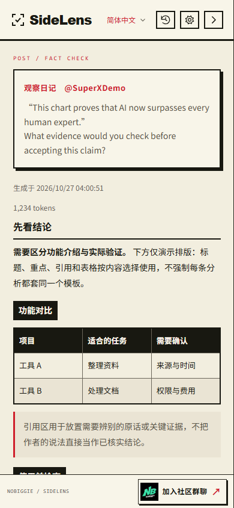
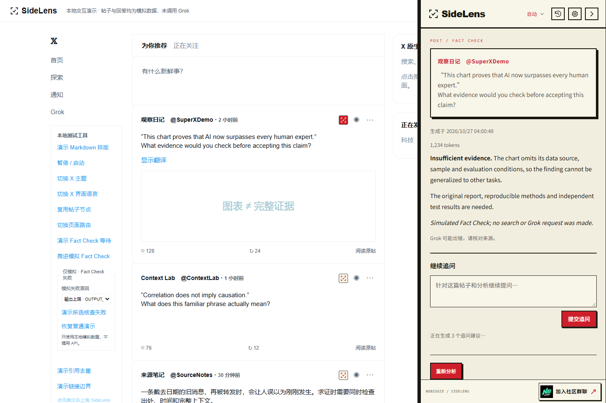
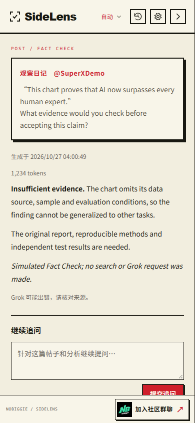

# SideLens 0.1.6 上架资料与致谢

2026-10-27。设置页底部增加独立「关于与致谢」区，明确写上「感谢原作者 @coolish 的贡献」，链接至作者 X 主页、原 SuperX 仓库和保留的 MIT 许可。隐私链接仍在独立页脚。

本版还补齐本地化短摘要、SideLens 产品主页和公开隐私政策链接，用于 Chrome 应用商店草稿准备。生成逻辑、模型设置及权限沿用 0.1.5。975 项自动化测试、67 项隔离浏览器检查通过；上架操作仍须用户最终确认，测试通过不代表商店已审核。

---

# SideLens 0.1.5 帖子图标与回复草稿

2026-10-27。用户要求恢复评论能力并增加偏好与长字数选项。原三条短评论底层并未删除，只移除了界面入口；本版使用独立的回复草稿模式，不改变三条追问建议的生成与校验。

- 帖子入口保持 22px，给每个按钮直接设置主题变量，使用本地 SVG 符号的 alpha mask，替代依赖继承颜色的行内 SVG。暗色底配珊瑚红图标，亮色底配深红图标；按钮及线条保持足够对比度。
- 「重新分析」下方新增「生成回复草稿」。语气：自然、专业、友好、犀利、幽默；方向：理性讨论、认同延伸、提出问题、审慎质疑、补充信息；目标字数：50/100/300/500/1000。字数是近似目标，同时显示实际 Unicode 字符数，包含标点与空格。
- 根据原帖、初次分析和最近三轮完整追问对话生成一份回复。长回复可以分段，不限制为一句话。选择当前提供方、模型、推理和输出语言；不额外搜索或虚构新核查、经历与他人背书。
- 回复可编辑并复制，绝不自动填入 X、提交或发布。生成只能由可信点击触发；偏好变更不自动调用模型。生成用量加入本页计数，长字数使用独立输出上限，不改变主核查与旧短评论的限制。
- 同追问一起仅留在当前页面内存；不进入持久缓存、历史或诊断。服务端仍按当前提供方政策处理数据。本机 Build 使用已有的无搜索草稿文本通道，不套用三条短评论 JSON 格式。

已通过 975 项自动化测试、66 项隔离浏览器检查，覆盖所有提供方的偏好与上下文传递、目标字数、拒绝无效偏好、聊天和草稿不落盘、按钮实际像素轮廓、三种主题、窄屏、编辑计数、复制和脚本点击防护。真实模型的篇幅与内容质量仍需安装后验收，本地预览是模拟数据。

以下为先前版本的实施记录。

---

# SideLens 0.1.4 外观、连续追问与社区入口

2026-10-27。根据用户要求：

- 自动采样 X 页面实际背景，匹配米白亮色、暗蓝与纯黑；保留 Noto Sans SC 14px/1.85、红色强调和 SideLens LOGO。抽屉、入口按钮、Markdown、草稿面板跟随切换。设置、弹窗、历史、连接与隐私页采用最近一次在 X 观察到的外观。
- 原核查结果下方加入输入框和提交按钮。按当前连接、模型、推理与搜索设置回答；传入原帖、初次分析以及最近三轮问答。回答流式追加，不覆盖初次结果。聊天只在当前页面内存中保留，刷新不恢复。
- 初次分析和每次追问回答后自动生成 3 条具体问题，点击即提交。建议不是原来的社交评论草稿，不使用原评论提示词。每次生成会增加提供方用量；初次建议按账号、模型及分析内容缓存在原有 24 小时/160 条/约 4 MB 总额度内，后续含聊天的建议不持久保存。失败可重试，不制造假建议。
- 右下角「加入社区群聊」链接到 https://nobiggie.xyz/chat，Logo 使用用户提供的原 PNG、本地打包；轻微摆动尊重减少动态效果设置。
- 复用可信端口、并发队列、凭据、取消和安全 Markdown；按角色和长度限制上下文，不新增权限、服务端或遥测。外观由可信 worker 存储，内容脚本不直接读取受限存储。Build 建议通过已有的无搜索结构化文本任务策略传输。

预览仍为模拟响应，未调用真实 Grok；真实账号下的连续追问与建议质量需要安装后验收。

验证：972 项自动化测试、52 项隔离浏览器检查通过。覆盖三种提供方的请求传递、初次建议缓存、聊天不持久化、输入角色与长度拒绝、取消后迟到结果抑制、主题幂等与文字对比度、两轮连续追问、建议刷新、防脚本触发、390px 布局及减少动态效果。

[纯黑预览](assets/sidelens-dark.png) · [暗蓝预览](assets/sidelens-dim.png) · [暗色设置页](assets/sidelens-options-dark.png)

以下为先前版本的实施记录。

---

# SideLens 0.1.3 核查重点与 Markdown 指令

2026-10-27。用户对同一篇推文的原版与 SideLens 输出进行对照后，授权优化生成指令。本版开始调整默认核查行为；下方 0.1.2 的“未修改模型请求指令”只描述该历史版本。

- 优先研究最影响读者判断的数字、比较、因果解释和未来推论。检查原始数据的日期、单位、范围、分母，以及有影响的统计方法与激励差异；根据线索继续搜索，避免停在概览页。
- 区分公告、已实现结果、作者推测和模型自己的分析；因果判断需要机制、条件及其它解释。搜寻后仍不足时，说明具体证据缺口，不把缺证当作证伪，也不强行反驳。
- 原文已有的常规确认合并或省略，不以无关技术细节填满答案。简单帖子无需强行展开复杂审计。
- 使用安全 Markdown：短标题、局部加粗，有共同维度的多项比较才用 2–3 列窄表格；引用只用于带归属的短原话。黑底标签和表头由现有样式呈现，不让模型生成 HTML、CSS 或颜色命令。
- 默认核查核心适用于公开帖子和草稿，覆盖 API、订阅登录、本机 Build。保留用户模型、推理档位、搜索开关及 1800 输出 Token 上限；真正编辑过的自定义指令不替换，仅迁移旧默认原样副本。共用格式指令也适用于自定义模式；超长草稿与自定义指令接近传输上限时使用简短格式提示，保留输入完整性。
- 提升缓存规则版本，旧规则的分析不会命中新请求；不主动发起分析，不删除历史，不改权限或凭据处理。

验证分为两部分：自动化检查验证请求、迁移、缓存和渲染；真实模型质量需在安装新版后，以同一推文、相同模型与推理档位强制重新分析。此前 BNB 示例的重点是是否实际追查交易量比较的统计口径、是否解释需求推论的依据；不预设这些主张的真假，也不把示例写进生成指令。本地预览仍是模拟内容。

本版已通过 962 项自动化测试和 34 项隔离浏览器检查；包含各提供方指令传递、原默认副本迁移、自定义指令保留，以及旧缓存不命中新请求、历史保留的回归检查。未代用户调用真实 Grok 生成。

以下为先前版本的实施记录。

---

# SideLens 0.1.2 字体与内容排版

2026-10-27。已采用用户选择：B / Noto Sans SC，正文 14px、行距 1.85、常规字重 400，重点 600。SideLens 的 Arial LOGO 字体保留。

- 标题加粗并用细线区分层次，小标题和表头使用黑底浅色文字。
- 引用使用红色左线与淡底，表格使用黑色表头和轻量隔行底色。
- 长段落若整段被 Markdown 粗体包裹，按普通正文显示；短重点仍加粗，内容不删除或重写。
- 表格、列表、标题、引用、代码和分隔线由现有安全 Markdown 渲染器处理；本轮不修改模型请求指令，不强制每次分析出现表格。
- 当前电脑已确认实际使用 Noto Sans SC。其它电脑未安装时回退到微软雅黑和系统无衬线；本版未打包字体文件或请求在线字体。
- 预览：/demo/index.html?provider=api&formatting=1，点击推文按钮查看。内容仅为模拟排版。
- 验证：959 项自动化测试、34 项隔离浏览器检查通过，含实际字体、14px/1.85、字重、黑底标签、表格、引用和窄屏检查。

以下为先前版本的实施记录。

---

# SideLens 0.1.1 更新

2026-10-27。

- 入口缩至 22px，按原生 Grok 按钮几何位置对齐，不参与原头部 flex 排版，并限制底边不遮挡正文。
- 移除分析面板的评论生成入口，设置中不再暴露评论提示词配置。
- 点击抽屉外可收起；抽屉内点击和另一条帖子按钮正常工作。
- 设置页底部仅保留 SideLens 隐私说明。
- 视觉改为参考图的米白纸面、黑色粗线、红色强调与硬阴影，保留 SideLens LOGO 字体。
- 本轮 958 项自动化测试、25 项隔离浏览器模拟检查通过。

以下为 0.1.0 的初始需求与实现记录；预览截图展示当前版本。

---

# SideLens 0.1.0 实施记录

2026-10-27。上游：SuperX 1.0.0，commit 5cfa125f9000866c1719afc452d1867ef37280bf。

## 已确认需求

1. UI 全面重做，参考 https://nobiggie.xyz/mint 的黑底、荧光黄绿、硬边框和粗体。
2. 推文右上角、Grok 左侧放按钮，点击后才提取并分析。
3. 使用右侧抽屉，只显示当前选择的一篇推文。
4. 刷新页面后可复用结果，并支持强制重新分析。
5. 其它能力沿用原项目，同时检查代码安全性。

## 实现

- 扫描阶段只挂载隔离按钮，移除停留触发与可见帖子批量提取。选中结果独立于 X 滚动、临时卸载和卡片高度。
- 保留后台流式消息、来源安全渲染、连接与重试。分析按钮、重新分析和评论生成拒绝脚本合成点击。
- 后台长连接统一校验扩展 ID、顶层 frame、标签页 ID 和 HTTPS X 来源。
- 本机持久缓存沿用 24 小时、160 条、约 4 MB 上限。凭据变更清空缓存，串行写入和 epoch 防止旧结果回写。
- 历史只记录主动打开的帖子。草稿回复链捕获推迟到主动核查；未被主动读取且已被 X 卸载的上级内容可能不可得。
- 主题与自有向量图标覆盖各扩展界面。内部协议名称及部分文件名保留上游标识以维持兼容。
- 原自动信息流和逐行对齐的测试替换为按需抽屉测试，保留提供方、凭据、Markdown、历史、限流和缓存等独立套件。

## 预览

预览为模拟响应，不调用 Grok。真实 X 登录态和实际生成尚未验收。
